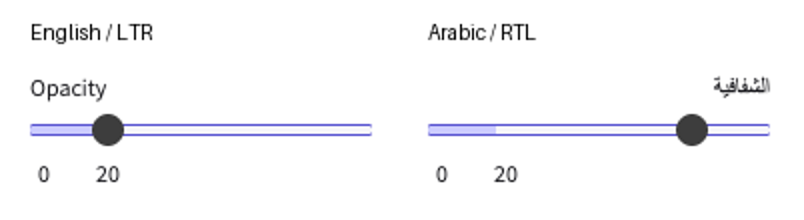

# RTL 不透明度控件 · 改前复现

目标分支基线 41f33a9581330d7eee664ad083274b1fe4576dea。实际浏览器复现在已有 PR 12 预览站点完成，尚未启动本缺陷分支。Range.tsx、Range.scss 以及 changeOpacity 对应代码已核对，相关实现与本缺陷分支一致。

Chrome 桌面 1200×800。分别设置英语与阿拉伯语，画同一个矩形，聚焦不透明度控件，按 Home 再按两次 ArrowUp，值均为 20。英语滑块与数值位于左侧 20% 附近。阿拉伯语滑块依照 RTL 位于右侧，而数值 20、零点与彩色轨道仍在左侧，造成错位。

代码依据：Range.scss 使用 to right 渐变、left 定位 value-bubble 和 zero-label，而原生 range 继承 rtl。当前仅证明显示错位，尚未改变代码或证明数值更新存在错误。
