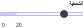
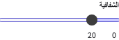
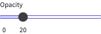
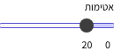

# RTL opacity fix verification

Issue: https://github.com/yangliang2/excalidraw/issues/13

## Acceptance

At the same opacity, the number must stay under the native slider thumb. The minimum label and filled track must follow the reading direction. Keyboard and pointer changes must retain their existing values. English must remain unchanged.

## Diagnosis and change

The native range input already honors RTL. Custom labels used physical `left` positions and the gradient always pointed right. This mismatch reproduced in Arabic and Hebrew in both the full panel and compact properties popup.

The fix uses `inset-inline-start` for labels and reverses the bubble translation and gradient for RTL. It does not change opacity values, drawing logic, or input keyboard semantics. `Range` currently has one caller, the opacity action.

## Reproducible browser check

```sh
corepack yarn install --frozen-lockfile
corepack yarn playwright install chromium
# Terminal 1
cd excalidraw-app
VITE_APP_ENABLE_ESLINT=false ../node_modules/.bin/vite --host 127.0.0.1 --port 5173 --strictPort
# Terminal 2, repository root
node scripts/browser/rtl-opacity.mjs
```

Optional environment variables: `BASE_URL`, `CHROME_PATH`, `ARTIFACT_DIR`.

Actual local run on 2026-11-18, Chromium supplied by Playwright 1.58.2:

- Before the CSS fix: **12 passed; 24 failed**, all RTL cases failed the minimum label alignment assertion.
- After the CSS fix: **36 passed; 0 failed**.
- Six scenarios: English, Arabic and Hebrew at widths 1200 and 800. The narrow layout opens the compact properties popup.
- Each scenario covers 0, 20, 50 and 100; a pointer click to 30; a direction-aware horizontal arrow key to 40.
- Assertions cover value, computed direction, minimum label alignment, gradient direction, bubble alignment and no duplicate label at zero.
- Existing style action tests: **6 passed** (`vitest run packages/excalidraw/tests/actionStyles.test.tsx`).

The new PR workflow runs this browser check unattended. Screenshots are written under `test-results/rtl-opacity`. Firefox, Safari and phone layouts are not covered by this check.

## Visual evidence

Arabic before (20 is detached from the thumb, 0 remains left):



Arabic after (20 under the thumb, 0 on the right):



English after:



Hebrew compact popup after:



## CI maintenance

The fork's master still contains the obsolete bundle-size workflow, which measures old output paths and relies on PR comment writes. Reuse the read-only baseline/candidate comparison already exercised in replay PR #12. It measures actual ESM JavaScript assets, retains budgets, and rejects any increase above an already-exceeded baseline. This is CI maintenance; it does not bring in replay product code.

PR review and manual product acceptance remain pending. No merge to master is performed.
